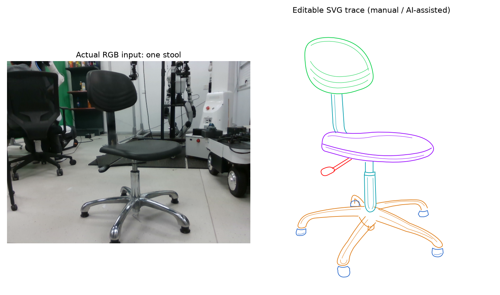
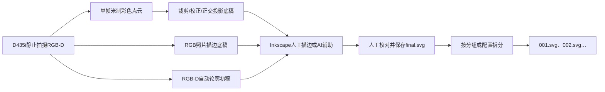

# 3DSVG Studio

**从一次 D435i 拍摄，到可编辑的 SVG 线稿，再到纯编号零件 SVG。**

这是一个本地 Python 命令行工具。可以自动提取RGB-D前景轮廓初稿，也可以生成点云/照片底稿。处理遮挡、区分零件和校对结果留给人工。描边困难时，可以使用 AI 辅助，再人工确认。

当前仅保留**一个椅子案例**作为发布示例：一组 RGB-D、相机内参，以及与这张 RGB 照片对应的线框和编号零件。它是带靠背的旋转凳，无扶手。工具可用于其他家具或物体。



> 示例线框使用照片透视人工/AI辅助描边，不是通过点云自动恢复的三维模型。两个轮子的缺失轮廓按用户要求人工估计补画，已保留来源标记。它没有实物尺寸标定。

## 工作流



三种底稿的几何含义不同：

| 底稿 | 用途 | 限制 |
| --- | --- | --- |
| 点云正交投影 | 调整三维观察方向，得到数学定义明确的平行投影参考图 | 单帧缺失的背面、黑色/反光材料的错误深度不会自动恢复 |
| RGB照片 | 当点云参考图断裂、难以描边时，用清楚照片画示意线稿 | 保留照片透视；图上线长不能换算成真实物体尺寸 |
| RGB-D自动轮廓 | 用深度范围辅助RGB分割，输出真正的矢量Path初稿 | 照片透视、像素坐标；可能误分背景，不能自动区分零件或恢复缺失结构 |

本工具不自动识别零件，不自动完成整椅轮廓。点云和照片不能当成同一投影坐标系混用。没有实现机器人、SLAM、Odometry、TSDF、Mesh或装配步骤规划。

## 环境与安装

已在 Windows 11、Python **3.14.4**、Open3D **0.20.0** 的现有 `.venv` 中验证。相机采集使用 pyrealsense2 **2.59.1.11053**；离线示例不需要连接相机。依赖见 [requirements-svg.txt](requirements-svg.txt)。

下载/克隆仓库后，在仓库根目录打开 PowerShell。已有可用 `.venv` 时直接使用；新环境可执行：

```powershell
python -m venv .venv
.\.venv\Scripts\python.exe -m pip install -r requirements-svg.txt
```

英文Windows或重定向日志时，建议先执行 `$env:PYTHONUTF8 = "1"`，避免中文日志因系统默认编码而报错。

Inkscape用于人工描边，需单独安装。脚本不依赖GPU、Streamlit或图形工作台，也不接入AI服务或要求API密钥。

## 先跑唯一示例：不连接相机

```powershell
.\.venv\Scripts\python.exe run_workflow.py prepare `
  --capture-dir examples/chair/capture `
  --output output/demo_01
```

默认生成两种底稿，供你比较后选择：

```text
output/demo_01/
  pointcloud.ply              # 原始RGB-D反投影，单位米
  pointcloud.json             # 反投影输入与深度比例记录
  pointcloud_template/
    cleaned.ply
    reference.png
    template.svg             # 点云正交投影底稿，空部件图层
    projection.json
  photo/
    edit.svg                 # RGB照片底稿，空部件图层
    measurements.json        # 实测尺寸，可保持空列表
    MANUAL_STEPS.md           # 当前文件的具体人工操作提示
    workbench.html           # 静态预览，非网页编辑器
    workflow.json
    input/                   # 原照片副本
```

**成功生成底稿不等于完成描边。** 本椅子的原始深度有缺失区域，照片路线通常更适合画清楚的示意轮廓。

重复运行请改为新输出目录，例如 `output/demo_02`。程序拒绝覆盖已有结果。

## 1. 拍摄自己的物体

先关闭RealSense Viewer及其他占用相机的程序。让整件物体含轮子/底座入框，保持静止，使用稳定光照和尽量简单的背景。

```powershell
$runId = Get-Date -Format 'yyyyMMdd_HHmmss'
$captureDir = "output/captures/$runId"
$workDir = "output/work/$runId"

.\.venv\Scripts\python.exe run_workflow.py capture --output $captureDir
```

在相机预览窗口按 **空格** 保存一组实际RGB-D；按 **q** 取消。程序会释放相机。若取消，不要继续处理该空目录。

采集保存 `color.png`、原始 `uint16 depth.png`、`camera_intrinsics.json`及采集记录。只保存单张，不做多帧重建。

## 2. 生成点云和SVG底稿

```powershell
.\.venv\Scripts\python.exe run_workflow.py prepare `
  --capture-dir $captureDir `
  --output $workDir
```

常用选项：

| 参数 | 默认值 | 说明 |
| --- | --- | --- |
| `--reference` | `both` | `pointcloud`仅正交投影；`photo`仅照片底稿；`both`两者 |
| `--azimuth` | −75° | 正交观察方位角 |
| `--elevation` | 15° | 正交观察俯仰角 |
| `--width` | 1600 | PNG实际宽度，保持横纵比例 |
| `--crop` | 不裁剪 | 六个数：xmin xmax ymin ymax zmin zmax；输入光学坐标轴，单位米 |

裁剪范围必须根据本次点云确定，不能照搬示例或旧扫描框。相机光学坐标是X右、Y下、Z前；脚本对显示姿态的转换不代表自动求得真实家具坐标。

已有PLY可直接使用更完整的投影入口：

```powershell
.\.venv\Scripts\python.exe run_3dsvg_studio.py `
  --input "你的点云.ply" --unit m --input-frame camera `
  --output output/ply_reference_01 --azimuth -75 --elevation 15
```

PLY通常没有单位声明，必须确认 `--unit m` 或 `--unit mm`。详见 [点云投影参数](docs/3DSVG_STUDIO_README.md)。

## 3. 人工描边，或使用AI辅助

### 可选：先自动提取轮廓

已拍摄的数据可以直接走这一条路线，不必先运行prepare，也不需要实体相机：

```powershell
.\.venv\Scripts\python.exe run_workflow.py auto-contours `
  --capture-dir $captureDir `
  --output "$workDir/auto_contours" `
  --roi 185 15 495 480 --min-depth 0.2 --max-depth 3.0
```

`--roi`是原RGB像素中的XMIN YMIN XMAX YMAX，右/下边界不包含。以上框仅适用于附带椅子示例；**自己的照片必须调整或省略ROI，不能照搬**。省略时默认排除画面最外圈作为背景样本，通常需要更简单的拍摄背景。

生成 `preview.png`、`foreground_mask.png`、矢量 `contours.svg`、含照片的 `editable.svg` 和 `report.json`。先查看预览，再用Inkscape打开editable.svg修正。可用 `--epsilon` 调整简化容差（默认1像素），`--min-area`过滤小轮廓（默认10像素面积），`--mask`使用人工修正的二值分割图。完整说明见[自动轮廓指南](docs/RGBD_AUTO_CONTOURS.md)。

**自动外轮廓不是按零件绘制的完整线框。** 椅背、坐垫和轮子等仍需结合原照片补画可见内部线，并分别分组。在final.svg副本中移除剩余 `auto_contours` 候选层，只保留校对后的零件组；仅隐藏候选层仍可能被拆分脚本导出。

自动轮廓使用原照片透视，不与点云正交模板混用。它是独立底稿，不能直接交给照片项目的 `export --reviewed`；校对后另存final.svg，再使用下面的统一split命令。

### 在Inkscape手工绘制

1. 选择一种底稿。照片路线打开 `photo/edit.svg`；点云路线打开 `pointcloud_template/template.svg`。
2. `Ctrl+Shift+L`显示图层，锁定Reference；选择Seat、Backrest、Support等部件层。没有的部件留空，其他物体可以重命名图层。
3. 按 **B**，沿可见结构用少量节点画路径；拖动产生曲线。按 **N** 调整节点和曲率。
4. `Ctrl+Shift+F`：填充设为无，描边设为部件颜色。开放轮廓按Enter结束；不能仅为“闭合”而补造缺失边缘。
5. 隐藏Reference和Guides，确认剩下实际可编辑的线条。显示照片/参考图再次校对，然后保存。
6. 按零件分组或分层，再另存为自己的 `final.svg`，保留原底稿。

尺寸需要卷尺实测或有依据的三维采样点，不能按照片或斜视图上线长猜测。

### 人工描绘有难度时

可以把本次RGB照片和对应SVG底稿交给AI，要求辅助绘制可编辑Path。AI生成后，仍需人工检查部件对应、遮挡、曲线和分组，并标记人工估计补线。

提供了可复制提示词、校对清单及错误处理：[AI辅助描边指南](docs/AI_ASSISTED_TRACING.md)。**新照片需要新描边，不得把本例的SVG直接套到另一张照片上。**

照片工作流还支持保存进度与去除底图后的版本导出：

```powershell
.\.venv\Scripts\python.exe run_photo_svg_workflow.py edit --project "$workDir/photo"
# 在Inkscape保存edit.svg并完成校对后，再运行：
.\.venv\Scripts\python.exe run_photo_svg_workflow.py export --project "$workDir/photo" --reviewed
```

得到 `photo/exports/version_0001/furniture.svg`；再次导出生成新版本。修改画布或更换照片会被拒绝，具体提示见项目内MANUAL_STEPS.md。

## 4. 自动拆成纯编号零件SVG

完成分组后执行：

```powershell
.\.venv\Scripts\python.exe run_workflow.py split `
  --input "你的final.svg" `
  --output output/my_parts_01 --trim --zip
```

输出 `001.svg`、`002.svg`……，**文件名只有编号，不含零件名称**。部件名称、选中ID与编号的关系在 `split_report.json` 和README中。默认依据已有图层/分组拆分，不做语义识别。

同一零件分在多个组，或多个轮子共用一层时，用JSON指定合并/拆分关系。当前椅子的可重复示例：

```powershell
.\.venv\Scripts\python.exe run_workflow.py split `
  --input examples/chair/final.svg `
  --output output/example_parts_01 `
  --config examples/chair/parts_config.json --trim --zip
```

这会得到11个编号零件。已附一份同样的结果在 [examples/chair/parts](examples/chair/parts)。

`--trim`只裁紧页面，不缩放原几何。复杂路径/资源无法安全裁紧时保留原画布并提示。已有目录或ZIP会拒绝覆盖。详见 [拆分脚本说明](docs/SVG_PARTS_SPLITTER.md)。

## 唯一示例的来源与限制

- `examples/chair/capture/`：同一时刻的一组真实RGB-D，Depth保持原始uint16；内参包含实际SDK比例。
- `examples/chair/final.svg`：依据该RGB照片制作的透视线稿，**不是点云正交投影的自动识别结果**。
- `examples/chair/parts/001.svg`～`011.svg`：从这份线稿拆出的零件；几何和颜色保留。
- `examples/chair/provenance.json`：文件校验、路线与人工补线说明。左后轮和下方轮子有人工估计补全，不能视为扫描实测。
- 图片包含当时实验室背景。本工具不会将背景自动当作目标物体的一部分，也不声称当前线稿是完整、精密或制造级模型。

原始DB3、其他扫描序列、实验Mesh、多视角数据、旧SVG试验与虚拟环境均不进入发布包。

## 目录

```text
3dsvg-studio/
  run_workflow.py            # capture / prepare / auto-contours / split
  rgbd_to_svg.py             # RGB-D自动分割与矢量轮廓初稿
  run_3dsvg_studio.py        # PLY → 数学正交投影底稿
  run_photo_svg_workflow.py  # 照片底稿、进度、校对后导出
  split_svg_parts.py         # 分组/配置 → 纯编号零件
  src/svg_isometric/         # 实际处理函数
  src/04_single_frame_pointcloud.py
  src/02_record_data.py      # 发布包只保留单张采集所需的流配置函数
  examples/chair/            # 仅这一个真实椅子案例
  config/
  docs/
  tests/
  scripts/build_github_release.py
  requirements-svg.txt
```

## 测试

```powershell
.\.venv\Scripts\python.exe -m unittest discover -s tests -v
```

测试覆盖真实算法调用、单位/颜色、正交投影、SVG映射、照片模板、相机资源释放的离线模拟、编号拆分和防覆盖。硬件模拟测试不代表已在新机器连接实体相机验收。

发布包与完整历史项目的测试数量不同，实际结果以随包的验证说明为准；没有执行GitHub远程CI或替你发布仓库。

本次集成已验证：完整项目261项通过，独立发布快照52项通过；真实RGB-D自动提取11条候选轮廓（10闭合、1开放），仍存在地面误分。先前的prepare和11个编号SVG拆分也已执行。详见[发布验证记录](docs/PUBLISH_VALIDATION.md)。

## 常见问题

| 现象 | 处理 |
| --- | --- |
| 相机启动失败 | 关闭Viewer/其他相机程序，检查USB与设备连接 |
| 点云参考图缺口很多 | 检查原始深度；可以选择RGB照片路线，不自动补出缺失面 |
| 只有PNG，没有真正线框 | SVG底稿只是容器，需要手工或AI辅助画Path |
| 画出来是一大块黑色 | 关闭填充，设置描边颜色 |
| 拆分后只有一个文件 | 原图只有一个分组；在Inkscape分零件或使用配置 |
| SVG没有分组 | 选中同一零件所有线条，Ctrl+G，设置唯一ID后保存 |
| 重跑提示目录已存在 | 换新目录；不覆盖旧人工成果 |
| 找不到Inkscape | 安装桌面版，再打开实际SVG路径 |

## 整理并上传GitHub

仓库以私有项目交付，不会默认授予开源许可证。若日后公开，请先由所有者决定代码和示例图片的许可范围。版本变化见[CHANGELOG](CHANGELOG.md)，参与开发见[贡献指南](CONTRIBUTING.md)。

已提供GitHub Actions的Windows / Python 3.14离线测试配置：安装依赖、运行测试、真实示例自动提取轮廓、拆分11个编号零件。相机采集不在云端CI运行。CI配置已准备，远程执行结果以上传后的Actions页面为准。

如果你在原来的历史项目目录中工作，先生成独立、经过文件白名单整理的发布目录：

```powershell
.\.venv\Scripts\python.exe scripts/build_github_release.py --output release/3dsvg-studio
```

安装并登录GitHub CLI后，也可用上传脚本校验发布文件，创建自己账号下的**私有**仓库并提交推送：

```powershell
gh auth login --hostname github.com --git-protocol https --web --scopes workflow
.\scripts\publish_github.ps1 -Package release/3dsvg-studio -RepoName 3dsvg-studio
```

首次运行脚本要求发布目录没有.git和额外文件；验证build_manifest.json中的SHA-256后再上传。脚本仅设置该发布目录的Git提交身份，使用GitHub账号的noreply邮箱。已有同名远程仓库时不会覆盖；推送异常保留本地提交供排查，不执行force push。

**上传 `release/3dsvg-studio` 的内容，不要上传整个历史chair_scanner目录。** 发布脚本不删除原项目数据。发布目录内路径可移动，不需要保留原电脑D盘路径。

可以在GitHub新建空仓库后，从发布目录执行（将远程URL换成自己的地址）：

```powershell
cd release/3dsvg-studio
git init
git add .
git commit -m "Initial 3DSVG Studio workflow"
git branch -M main
git remote add origin "https://github.com/YOUR_USERNAME/3dsvg-studio.git"
git push -u origin main
```

`.gitignore`排除`.venv`、运行输出、原始录制与缓存；仅examples/chair作为示例数据进入仓库。不要将令牌、账号配置或API密钥写入代码。
