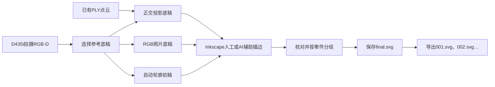

# 3DSVG Studio

**从RGB-D拍摄或已有点云，制作可编辑SVG线稿，并导出纯编号零件文件。**

3DSVG Studio是一个本地Python命令行工具，适用于家具及其他物体的轮廓整理。脚本负责采集、生成参考底稿、提取候选轮廓和拆分文件；人工负责修正边界、判断遮挡和划分零件。描边困难时，可使用AI辅助绘制，再进行人工校对。


> 示例是带靠背的旋转凳。线稿使用照片透视，两处轮子轮廓含已标记的人工估计补线；它不是自动恢复的三维模型，也没有实物尺寸标定。

## 完整工作流



| 参考方式 | 适合的情况 | 几何含义 |
| --- | --- | --- |
| RGB-D自动轮廓 | 先提取前景边界，再修正和分零件 | RGB照片透视，单位为像素；可能误分背景或漏掉细杆 |
| RGB照片 | 照片清楚，但深度不完整 | 保留透视，不能按线长换算实物尺寸 |
| 点云正交投影 | 已有可靠点云，需要调整观察方向 | 平行投影；缺失的几何仍然缺失 |

自动轮廓提供真正的SVG Path，但不会自动识别椅背、坐垫等语义零件。三种底稿的坐标映射不同，应选定一种后完成描边。

## 安装

验证环境为Windows 11、Python 3.14、Open3D 0.20.0。具体版本见[requirements-svg.txt](requirements-svg.txt)。连接D435i时需要可用的RealSense SDK和USB连接；离线示例不需要相机。

```powershell
git clone https://github.com/lilili-maker/3dsvg-studio.git
cd 3dsvg-studio
python -m venv .venv
.\.venv\Scripts\python.exe -m pip install -r requirements-svg.txt
$env:PYTHONUTF8 = "1"
$env:PYTHONIOENCODING = "utf-8"
```

已有可用虚拟环境时，可直接使用其中的Python。Inkscape需要单独安装；AI辅助是可选的，脚本不调用AI服务，也不需要API密钥。

## 快速体验：使用附带示例

仓库附带一组真实RGB-D、对应线稿及11个编号零件。以下命令不连接相机：

```powershell
$demo = "output/demo_$(Get-Date -Format 'yyyyMMdd_HHmmss')"

# 生成点云正交底稿和照片底稿，供选择。
.\.venv\Scripts\python.exe run_workflow.py prepare `
  --capture-dir examples/chair/capture --output "$demo/templates"

# 同一张照片的自动轮廓初稿，仍需校对。
.\.venv\Scripts\python.exe run_workflow.py auto-contours `
  --capture-dir examples/chair/capture --output "$demo/auto_contours" `
  --roi 185 15 495 480

# 拆分附带的已校对线稿，演示编号导出。
.\.venv\Scripts\python.exe run_workflow.py split `
  --input examples/chair/final.svg --output "$demo/parts" `
  --config examples/chair/parts_config.json --trim --zip
```

查看`auto_contours/preview.png`，用Inkscape打开`auto_contours/editable.svg`。示例自动分割存在地面误分和金属腿缺漏；附带的`final.svg`是另外完成并校对的照片线稿，不是该自动初稿的直接输出。

## 从自己的物体拍摄到零件SVG

关闭RealSense Viewer等占用相机的程序，保持物体静止，让整件物体进入画面。背景简单、光照稳定时更容易提取轮廓。

```powershell
$runId = Get-Date -Format 'yyyyMMdd_HHmmss'
$captureDir = "output/captures/$runId"
$workDir = "output/work/$runId"

.\.venv\Scripts\python.exe run_workflow.py capture --output $captureDir
```

预览窗口按**空格**保存一组RGB-D，按**q**取消。拍摄完成后应包含`color.png`、原始`uint16 depth.png`和`camera_intrinsics.json`。取消或未保存时，请先重新拍摄。

使用本次RGB-D提取自动轮廓：

```powershell
.\.venv\Scripts\python.exe run_workflow.py auto-contours `
  --capture-dir $captureDir --output "$workDir/auto_contours" `
  --min-depth 0.2 --max-depth 3.0
```

背景复杂时追加`--roi XMIN YMIN XMAX YMAX`，数值为原RGB像素，右/下边界不包含。ROI需要根据本次照片确定，不能套用示例的框。`--epsilon`控制简化容差，默认1像素；`--min-area`默认过滤小于10像素面积的轮廓。更多参数见[自动轮廓指南](docs/RGBD_AUTO_CONTOURS.md)。

接下来需要人工操作：

1. 查看`preview.png`，确认背景、细杆和孔洞是否误分。
2. 在Inkscape打开`editable.svg`，锁定Reference图层。按**N**调整节点，按**B**补画照片中可见的内部结构线。
3. 填充设为无，按零件设置描边颜色；开放轮廓保持开放。
4. 把同一独立零件的路径放入一个有唯一ID的分组或图层，轮子等独立零件分别分组。
5. 在最终副本中移除剩余`auto_contours`候选层，隐藏Reference，保存为本次工作目录下的`final.svg`。仅隐藏候选层仍可能被拆分脚本导出。

描边困难时，可把本次照片和对应SVG交给AI辅助绘制可编辑Path，再逐项校对。提示词见[AI辅助描边指南](docs/AI_ASSISTED_TRACING.md)。新照片需要重新描边；估计补线应单独标记来源。

完成校对和分组后导出：

```powershell
.\.venv\Scripts\python.exe run_workflow.py split `
  --input "$workDir/final.svg" --output "$workDir/parts" --trim --zip
```

输出文件名为`001.svg`、`002.svg`……，不含零件名称。编号、标签和路径ID的对应关系保存在`split_report.json`。拆分依据已有分组或明确配置，不自动识别物体结构。

## 使用照片或点云参考底稿

自动分割不理想时，可以生成适合人工描边的底稿：

```powershell
.\.venv\Scripts\python.exe run_workflow.py prepare `
  --capture-dir $captureDir --output "$workDir/templates" --reference both
```

照片路线打开`templates/photo/edit.svg`，点云路线打开`templates/pointcloud_template/template.svg`。按零件描边并另存最终SVG后，使用相同的`split`命令。

| 参数 | 作用 |
| --- | --- |
| `--reference both/pointcloud/photo` | 选择底稿类型，默认both |
| `--azimuth` / `--elevation` | 点云投影方位角和俯仰角，默认−75°和15° |
| `--width` | 点云参考PNG宽度，默认1600像素，保持横纵比例 |
| `--crop` | 输入点云轴的AABB：xmin xmax ymin ymax zmin zmax，单位米 |

已有PLY可以直接投影：

```powershell
.\.venv\Scripts\python.exe run_3dsvg_studio.py `
  --input "object.ply" --unit m --input-frame camera `
  --output output/ply_reference --azimuth -75 --elevation 15
```

上例仅适用于单位为米、使用相机光学坐标的PLY；其他来源需要明确单位与坐标定义。参数见[点云投影说明](docs/3DSVG_STUDIO_README.md)。

照片项目还支持记录进度和校对后导出，见生成的`MANUAL_STEPS.md`。该出口只接受对应照片项目的`edit.svg`；自动轮廓的`editable.svg`应直接校对、另存后拆分。

## 输出文件

| 文件或目录 | 内容 |
| --- | --- |
| `auto_contours/preview.png` | 自动分割与轮廓预览 |
| `auto_contours/foreground_mask.png` | 可人工修正的0/255二值前景图 |
| `auto_contours/contours.svg` | 不含底图的候选矢量路径 |
| `auto_contours/editable.svg` | 嵌入照片的可编辑初稿和零件图层 |
| `auto_contours/report.json` | 参数、来源校验和轮廓统计 |
| `templates/` | 所选路线的照片或点云底稿 |
| `final.svg` | 人工校对并另存的最终线稿 |
| `parts/` 与 `parts.zip` | 纯编号零件、拆分报告和说明 |

程序拒绝覆盖已有输出目录。更换输出路径即可重复尝试，原始RGB-D和人工成果会保留。

## 精度、示例与限制

- 照片和自动轮廓保留透视，线长不能当作实物尺寸；真实尺寸需单独测量。
- 点云投影保留已有几何比例，但无法恢复未观测的背面或错误深度。
- 自动外轮廓不足以区分全部零件，背景误分、细金属腿和遮挡需要校对。
- [示例来源记录](examples/chair/provenance.json)说明估计补线和文件校验；示例不代表完整、精密的实物模型。
- 录制及运行输出默认放在被`.gitignore`排除的目录。仓库只附一个真实案例，其他物体需使用自己的输入。

需要连续环绕拍摄并生成Mesh，可参见[D435i Handheld Reconstruction](https://github.com/lilili-maker/d435i-handheld-reconstruction)。

## 测试与文档

```powershell
.\.venv\Scripts\python.exe -m unittest discover -s tests -v
```

当前包含52项离线测试，覆盖投影、尺度、RGB-D轮廓、SVG映射、编号拆分及防覆盖。[GitHub Actions](https://github.com/lilili-maker/3dsvg-studio/actions)还运行真实示例的轮廓提取和零件导出。相机硬件与人工描边质量需另外检查。

- [AI辅助描边](docs/AI_ASSISTED_TRACING.md)
- [自动轮廓参数](docs/RGBD_AUTO_CONTOURS.md)
- [SVG拆分与配置](docs/SVG_PARTS_SPLITTER.md)
- [验证范围与示例结果](docs/PUBLISH_VALIDATION.md)
- [更新记录](CHANGELOG.md) · [参与开发](CONTRIBUTING.md)

## 许可

当前未附开源许可证。代码与示例素材的复制、修改及再分发范围以仓库所有者的授权为准。
