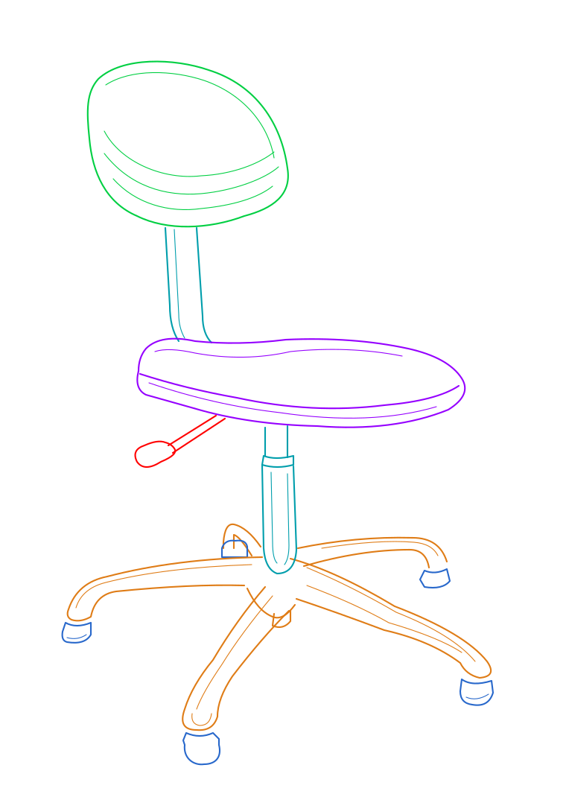
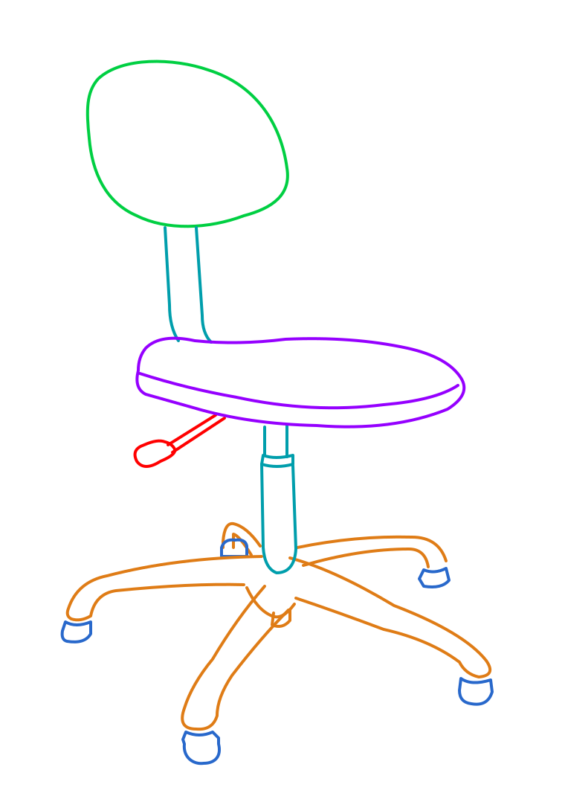

# 3DSVG Studio

将 RGB-D 图像或 PLY 点云转换为 SVG 描边底稿，并按零件分组导出独立文件。

处理流程为：采集 RGB-D → 生成参考图或候选轮廓 → Inkscape 校对、描边与分组 → 导出编号 SVG。自动轮廓用于辅助起稿，零件划分和遮挡关系仍需人工判断。

## 示例

仓库包含同一把旋转凳的两个线稿版本，每版均附 11 份编号零件。

| 细节版：43 条路径 | 精简版：26 条路径 |
| --- | --- |
| [整图 SVG](examples/chair/final.svg) · [编号零件](examples/chair/parts/) | [整图 SVG](examples/chair/simplified/final.svg) · [编号零件](examples/chair/simplified/parts/) |
|  |  |

精简版删除了 17 条装饰和高光线，保留结构轮廓并加粗。两版均沿用照片透视；两处轮子轮廓含人工估计补线，文件中保留了来源标记。示例未做实物尺寸标定，详见[示例说明](examples/chair/README.md)。

## 环境与安装

已验证环境：Windows 11、Python 3.14、Open3D 0.20.0。依赖版本见 [requirements-svg.txt](requirements-svg.txt)。相机采集需要 D435i 及兼容的 RealSense SDK；Inkscape 需单独安装。

```powershell
git clone https://github.com/lilili-maker/3dsvg-studio.git
cd 3dsvg-studio
python -m venv .venv
.\.venv\Scripts\python.exe -m pip install -r requirements-svg.txt
$env:PYTHONUTF8 = "1"
$env:PYTHONIOENCODING = "utf-8"
```

已有虚拟环境时，可直接使用对应的 Python。以下命令均在仓库根目录执行。

## 运行附带示例

此示例使用仓库中的 RGB-D 文件，无需连接相机。

```powershell
$demo = "output/demo_$(Get-Date -Format 'yyyyMMdd_HHmmss')"

# 提取候选轮廓。
.\.venv\Scripts\python.exe run_workflow.py auto-contours `
  --capture-dir examples/chair/capture --output "$demo/auto_contours" `
  --roi 185 15 495 480

# 将附带的精简线稿拆成 001.svg～011.svg。
.\.venv\Scripts\python.exe run_workflow.py split `
  --input examples/chair/simplified/final.svg --output "$demo/parts" `
  --config examples/chair/simplified/parts_config.json --trim --zip
```

`auto_contours/preview.png` 显示分割结果，`editable.svg` 可在 Inkscape 中编辑。此示例的自动轮廓存在地面误分和金属腿缺漏；附带线稿经过另外描绘和校对，并非自动提取的直接结果。

## 拍摄自己的物体

关闭 RealSense Viewer，保持物体静止，尽量让完整物体进入画面。

```powershell
$runId = Get-Date -Format 'yyyyMMdd_HHmmss'
$captureDir = "output/captures/$runId"
$workDir = "output/work/$runId"

.\.venv\Scripts\python.exe run_workflow.py capture --output $captureDir
```

预览窗口按空格保存，按 q 取消。保存内容包括 `color.png`、原始 `uint16 depth.png` 和 `camera_intrinsics.json`。

```powershell
.\.venv\Scripts\python.exe run_workflow.py auto-contours `
  --capture-dir $captureDir --output "$workDir/auto_contours" `
  --min-depth 0.2 --max-depth 3.0
```

背景复杂时，可加 `--roi XMIN YMIN XMAX YMAX` 限定前景区域。坐标使用原图像素，右、下边界不包含；应根据本次照片设置。`--epsilon` 是轮廓简化容差，默认 1 像素；`--min-area` 默认过滤面积小于 10 像素的轮廓。其余参数见[自动轮廓说明](docs/RGBD_AUTO_CONTOURS.md)。

## 描边、分组与导出

在 Inkscape 中打开 `auto_contours/editable.svg`，锁定 Reference 图层。用节点工具（N）修正边界，用贝塞尔工具（B）补画可见结构线，填充设为无。开放边界按实际可见情况保留。

同一零件的路径放入一个具有唯一 ID 的分组或图层，轮子等独立零件分别分组。另存 `final.svg` 前，在副本中移除剩余的 `auto_contours` 候选层，并隐藏 Reference。仅隐藏候选层仍可能被拆分脚本导出。

描边困难时可使用 AI 辅助起稿，再人工检查结构和分组。[提示词模板](docs/AI_ASSISTED_TRACING.md)随仓库提供，程序本身不调用 AI 服务。估计补线应保留来源标记。

```powershell
.\.venv\Scripts\python.exe run_workflow.py split `
  --input "$workDir/final.svg" --output "$workDir/parts" --trim --zip
```

零件文件按 `001.svg`、`002.svg` 等编号命名。编号与零件标签的对应关系保存在 `split_report.json`；拆分依据已有分组或配置文件，不进行自动零件识别。

## 照片和点云底稿

自动轮廓效果不足时，可改用照片或点云投影作为描边参考。

```powershell
.\.venv\Scripts\python.exe run_workflow.py prepare `
  --capture-dir $captureDir --output "$workDir/templates" --reference both
```

照片底稿为 `templates/photo/edit.svg`，点云底稿为 `templates/pointcloud_template/template.svg`。`--reference` 可取 `both`、`photo` 或 `pointcloud`。

已有 PLY 可直接生成正交投影：

```powershell
.\.venv\Scripts\python.exe run_3dsvg_studio.py `
  --input object.ply --unit m --input-frame camera `
  --output output/ply_reference --azimuth -75 --elevation 15
```

上例输入采用米制相机光学坐标。其他来源的点云需核对单位和坐标定义。`--azimuth`、`--elevation` 设置观察角度，`--width` 默认 1600 像素；`--crop` 接受 `xmin xmax ymin ymax zmin zmax` 六个米制边界。详见[点云投影说明](docs/3DSVG_STUDIO_README.md)。

照片底稿保留透视，点云底稿使用正交投影，两者不能混用坐标。照片项目的导出方法见生成的 `MANUAL_STEPS.md`；自动轮廓底稿应按前文另存后拆分。

## 输出

| 文件 | 内容 |
| --- | --- |
| `preview.png`、`foreground_mask.png` | 分割预览及可修改的二值掩膜 |
| `contours.svg`、`editable.svg` | 候选路径及带参考图的编辑底稿 |
| `report.json` | 提取参数、输入校验和轮廓统计 |
| `final.svg` | 人工校对后的线稿 |
| `parts/`、`parts.zip` | 编号零件、拆分报告及说明 |

已有输出目录不会被覆盖，重复运行时请更换路径。

照片线长没有实物尺度含义，尺寸需另行测量。点云投影保留输入几何的比例，也会保留缺面和深度误差。当前结果适合作为人工描边参考，不能据此认定物体结构完整或尺寸准确。需要连续扫描和 Mesh 重建时，可使用 [D435i Handheld Reconstruction](https://github.com/lilili-maker/d435i-handheld-reconstruction)。

## 测试与文档

```powershell
.\.venv\Scripts\python.exe -m unittest discover -s tests -v
```

现有 52 项离线测试，覆盖投影、单位转换、轮廓提取、SVG 映射和零件拆分。[GitHub Actions](https://github.com/lilili-maker/3dsvg-studio/actions)另执行示例数据的轮廓提取与导出。

- [自动轮廓参数](docs/RGBD_AUTO_CONTOURS.md)
- [SVG 拆分配置](docs/SVG_PARTS_SPLITTER.md)
- [实验与验证结果](docs/PUBLISH_VALIDATION.md)
- [更新记录](CHANGELOG.md) · [贡献说明](CONTRIBUTING.md)

## 许可

仓库尚未附开源许可证。代码与示例素材的复制、修改及再分发需获得相应授权。
